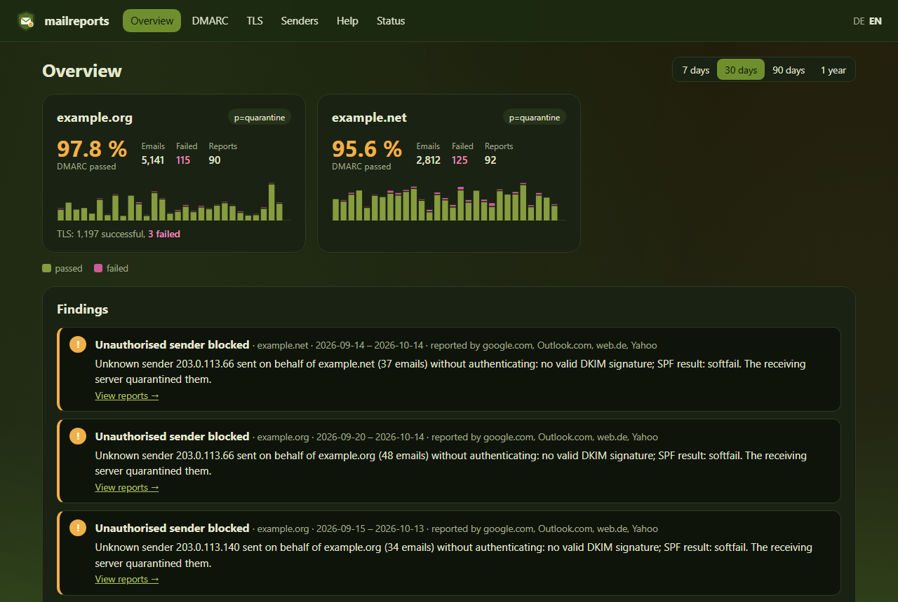
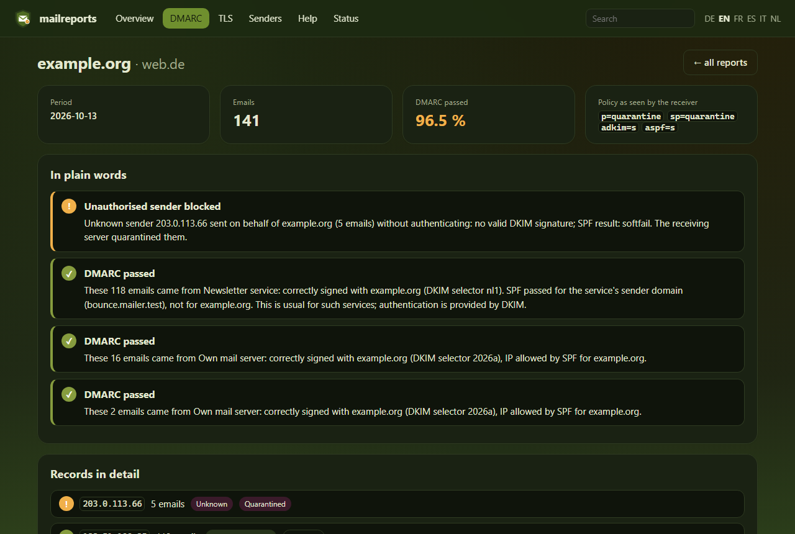
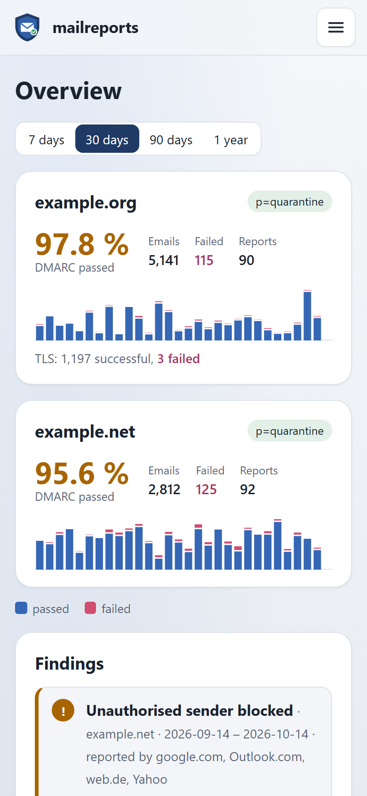

<p align="center"></p>

# mailreports

[English](README.md) · **Deutsch**

<p align="center">
  
  <a href="https://github.com/Schnuecks/mailreports/pkgs/container/mailreports"></a>
  
  <a href="https://github.com/Schnuecks/mailreports/actions/workflows/ci.yml"></a>
  <a href="https://github.com/Schnuecks/mailreports/actions/workflows/zap.yml"></a>
  <a href="LICENSE"></a>
  
</p>

mailreports ist ein kleiner, selbstgehosteter Viewer für die Berichte, die Mailanbieter
über deine Domains verschicken. Er holt **DMARC-Aggregate-Berichte** und
**SMTP-TLS-Berichte** aus einem IMAP-Postfach und erklärt sie im Klartext: wer in deinem
Namen Mails verschickt hat, ob sie echt waren und was die empfangenden Server damit gemacht
haben – statt XML und Fehlercodes.



## Funktionen

- **Übersicht** pro Domain mit DMARC-Bestehensquote, Verlauf pro Tag, veröffentlichter
  Richtlinie und TLS-Ergebnissen, für 7, 30 oder 90 Tage oder ein Jahr
- **Klartext-Erklärungen** für jeden Berichtseintrag, z. B. „Diese 118 Mails kamen von
  Newsletter-Dienst: korrekt mit example.org signiert (DKIM-Selektor nl1).“, und für jeden
  TLS-Fehlertyp, mit dem, was zu tun ist
- **Einordnung der Absender:** eigener Server, beauftragte Dienste (zum Beispiel am
  DKIM-Selektor), Weiterleitungen und Unbekannte, mit Reverse-DNS und optional Land und Netz
  (AS) per GeoIP; bekannte Absender trägst du mit einem Klick bei einer unbekannten IP in der App
  ein oder in einer Datei
- **Berichtsdetails** mit jeder DKIM-Signatur und jedem Selektor, der SPF-Prüfung,
  Header-From und Envelope-From; die Originaldatei zum Herunterladen und alle Einträge als
  CSV-Export
- **DNS-Prüfung** der eigenen Domains: DMARC, SPF (inkl. der Grenze von 10 Abfragen),
  DKIM-Schlüssellängen, MTA-STS, TLS-RPT, MX und DANE, BIMI – und einmal täglich im Hintergrund,
  mit einer Meldung, wenn sich ein Eintrag ändert oder ein neues Problem auftaucht
- **Empfehlung zur Richtlinie:** wann ein Wechsel auf `p=quarantine` oder `p=reject` sicher ist
  und was vorher zu klären ist
- **Eine Seite je sendender IP** mit Verlauf und allen Einträgen, dazu eine Suche über
  IP-Adressen, Hostnamen, Domains, Berichtersteller und DKIM-Selektoren
- **IMAP-Abruf** über TLS; Berichte als `.xml`, `.json`, `.gz` oder `.zip`, egal mit welchem
  MIME-Typ. Mails werden markiert oder verschoben, nie gelöscht, oder im Lesemodus gar nicht
  angefasst. Doppelte Berichte werden erkannt.
- **Benachrichtigungen** über Pushover, ntfy, Webhook oder E-Mail bei neuen Fehlschlägen,
  unbekannten Absendern und TLS-Problemen, höchstens einmal am Tag pro Fund, dazu optional eine
  **Wochenübersicht** – einzurichten in der App oder über Umgebungsvariablen
- **Kennzahlen** als JSON und im Prometheus-Format für Dashboards
- **Aufbewahrung:** Berichte, die älter als eine einstellbare Zahl von Tagen sind, werden
  automatisch gelöscht
- **Benutzerkonten** mit den Rollen Administration und Lesezugriff, **Zwei-Faktor-Anmeldung**
  mit Authenticator-App und Wiederherstellungscodes, **Passkeys und Sicherheitsschlüssel**,
  **Single Sign-on** über einen OpenID-Connect-Anbieter (z. B. Authelia) und ein
  Anmeldeprotokoll – oder Anmeldung über deinen Reverse-Proxy mit Forward-Auth-Headern wie
  `Remote-User`
- **Geheimnisse aus Dateien** (`IMAP_PASSWORD_FILE`, `PUSHOVER_TOKEN_FILE`, …) für Docker-Secrets
- **Hochladen und Importieren** älterer Berichtsdateien, **Hilfeseiten** zu SPF, DKIM,
  DMARC, Ausrichtung und TLS-Reporting
- **Sechs Sprachen** (Deutsch, Englisch, Französisch, Spanisch, Italienisch, Niederländisch),
  helles und dunkles Design (neutral oder Olivgrün), auch fürs Handy
- **Klein und einfach zu betreiben:** ein Container, eine SQLite-Datei, läuft ohne
  Root-Rechte mit schreibgeschütztem Dateisystem und eingebautem Healthcheck

| Ein Bericht im Klartext | Handy |
|---|---|
|  |  |

## Schnellstart

Du brauchst Docker mit Docker Compose und ein Postfach, in dem die Berichte ankommen (die
`rua=`-Adresse deines DMARC-Eintrags und die Adresse deines TLS-RPT-Eintrags).

```bash
mkdir mailreports && cd mailreports
curl -O https://raw.githubusercontent.com/schnuecks/mailreports/main/compose.yaml
curl -o .env https://raw.githubusercontent.com/schnuecks/mailreports/main/.env.example
curl -o sources.toml https://raw.githubusercontent.com/schnuecks/mailreports/main/sources.example.toml
mkdir data secrets && sudo chown 10001 data
printf '%s' 'dein-imap-passwort' > secrets/imap_password.txt
docker compose up -d
```

Vorher in `.env` `IMAP_HOST` und `IMAP_USER` eintragen und in `sources.toml` deinen eigenen
Mailserver beschreiben. Dann `http://<server>:8080` öffnen und das erste Konto anlegen; der Einrichtungscode steht im
Log (`docker compose logs mailreports`). Die ersten Berichte kommen innerhalb eines Tages. Aktualisieren: `docker compose pull && docker compose up -d`.

Für den Zugriff über das Internet gehört es hinter einen Reverse-Proxy mit Anmeldung; siehe
[Installation](docs/de/installation.md). Berichte sind nicht signiert und die Berichtsadresse ist
öffentlich, jeder kann also erfundene Berichte dorthin schicken: `DOMAINS` auf die eigenen Domains
setzen, dann werden Berichte für andere Domains nicht gespeichert.

## Dokumentation

- [Installation](docs/de/installation.md): DNS-Einträge, Docker, Reverse-Proxy und
  Anmeldung, GeoIP, alte Berichte importieren, Aktualisieren
- [Einstellungen](docs/de/configuration.md): alle Einstellungen und die Datei mit bekannten Absendern
- [Bedienung](docs/de/usage.md): was die Seiten zeigen, wie Absender eingeordnet werden, Kommandozeile
- [Entwicklung](docs/de/development.md): lokal starten, Tests, Übersetzungen, Screenshots

Was sich in welcher Version geändert hat, steht im [CHANGELOG](CHANGELOG.md).

## Sicherheit

Jeder kann eine Mail an die Adresse in deinem DMARC-Eintrag schicken, deshalb behandelt
mailreports jeden Bericht als nicht vertrauenswürdig:

- **Einlesen:** XML über `defusedxml`, eine gemeinsame Größengrenze für alles, was aus einer Mail
  entpackt wird, und eine Grenze für die Zahl der Dateien in einem Archiv (keine ZIP-Bomben).
- **Anmeldung:** Begrenzung fehlgeschlagener Anmeldungen je Adresse und je Benutzer auch hinter
  einem Reverse Proxy, Passkeys, Single Sign-on, das nie ein Admin-Konto über seinen Namen
  übernimmt, CSRF-Tokens und Herkunftsprüfung, eine strikte Content-Security-Policy.
- **Bei jeder Änderung geprüft:** Tests, Trivy-Scan des Images, OWASP-ZAP-Baseline-Scan,
  Dependabot.
- **Überprüft:** Vor der Veröffentlichung ein KI-gestützter Sicherheits-Review; jeder Fund wurde
  mit einem Test nachgestellt, behoben und erneut geprüft – nachzulesen im
  [Changelog](CHANGELOG.md).

Sicherheitslücken bitte vertraulich melden, siehe [SECURITY.md](SECURITY.md).

## Wie es entsteht

mailreports entsteht mit Unterstützung eines KI-Assistenten. Funktionen und Verhalten lege ich
fest, prüfe die Änderungen und teste sie an meinem eigenen Mailserver. Veröffentlicht wird nur,
was die automatischen Prüfungen besteht: die Tests und ein Sicherheitsscan des Containers.

## Unterstützen

mailreports ist kostenlos und bleibt es. Wenn es dir Zeit spart, kannst du mir einen Kaffee
ausgeben; das hält das Projekt am Laufen. Danke!

<p>
  <a href="https://ko-fi.com/schnuecks"></a>
</p>

## Rückmeldungen

Fehler und Ideen sind als [Issue auf GitHub](https://github.com/schnuecks/mailreports/issues)
willkommen. Wird ein Bericht falsch gelesen oder erklärt, häng bitte die Datei an, mit
ersetzten eigenen Domains und IP-Adressen. Siehe auch [CONTRIBUTING](CONTRIBUTING.md) und
[SECURITY](SECURITY.md).

## Lizenz

Copyright (C) 2026 Schnuecks

mailreports ist freie Software unter der
[GNU Affero General Public License, Version 3 oder später](LICENSE)
(AGPL-3.0-or-later). Du darfst es nutzen, verändern und weitergeben.

Gibst du eine veränderte Fassung weiter oder bietest sie anderen über ein Netzwerk zur
Nutzung an, musst du ihnen den Quellcode deiner Fassung unter derselben Lizenz
zugänglich machen. Der Link „Quellcode auf GitHub“ im Footer erfüllt das für diese
Fassung; bei einer eigenen Fassung richte ihn mit `SOURCE_URL` auf deinen Quellcode.

Das Programm wird ohne jede Gewährleistung bereitgestellt. Einzelheiten stehen in der
[Lizenz](LICENSE). Die optionalen GeoIP-Daten stammen aus den GeoLite2-Datenbanken von
MaxMind, die du selbst unter deren Lizenz herunterlädst; mailreports enthält sie nicht.
